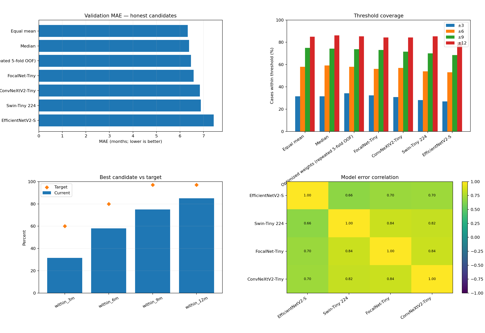
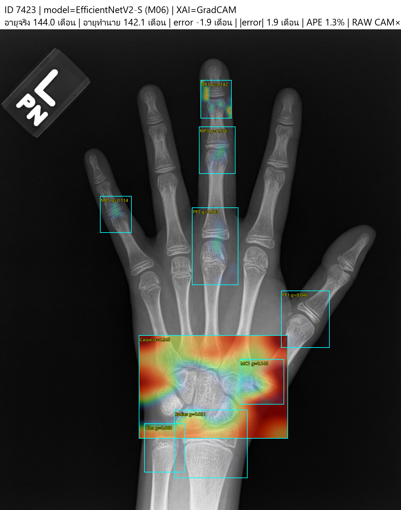
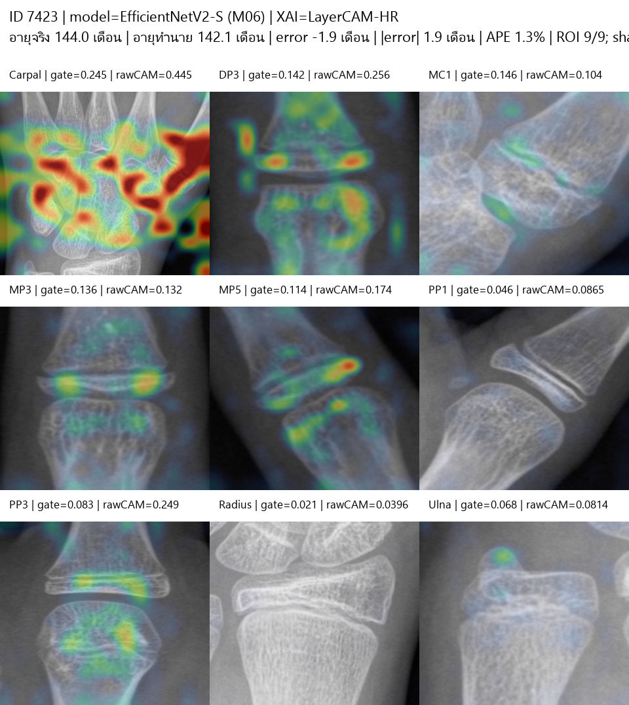
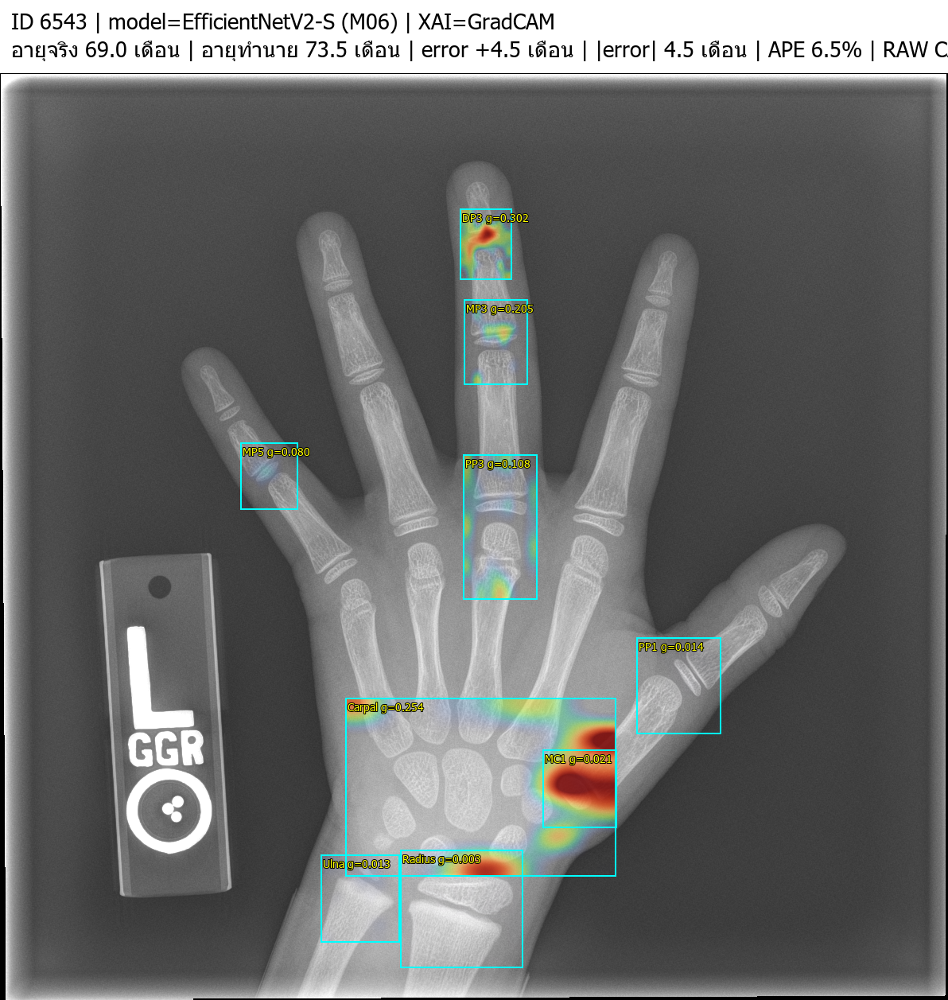
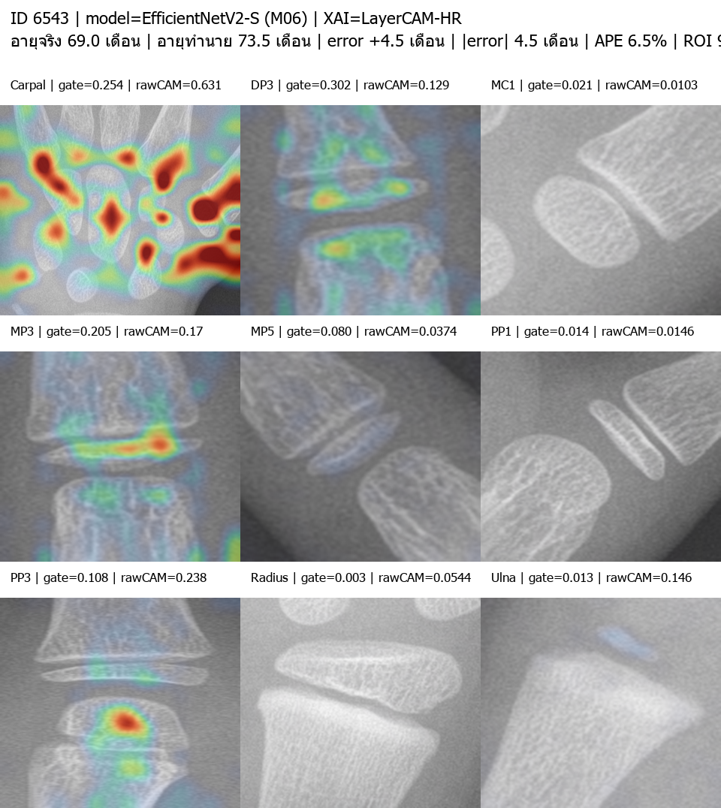
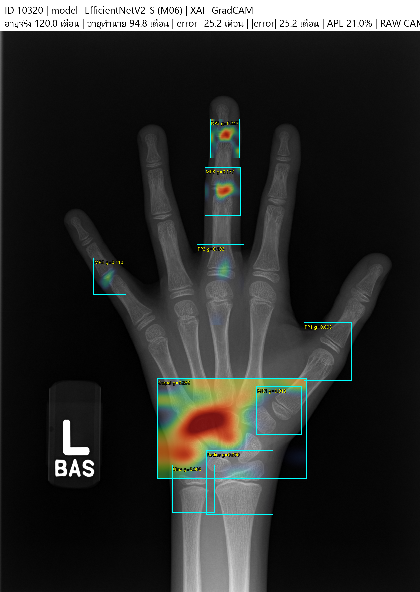
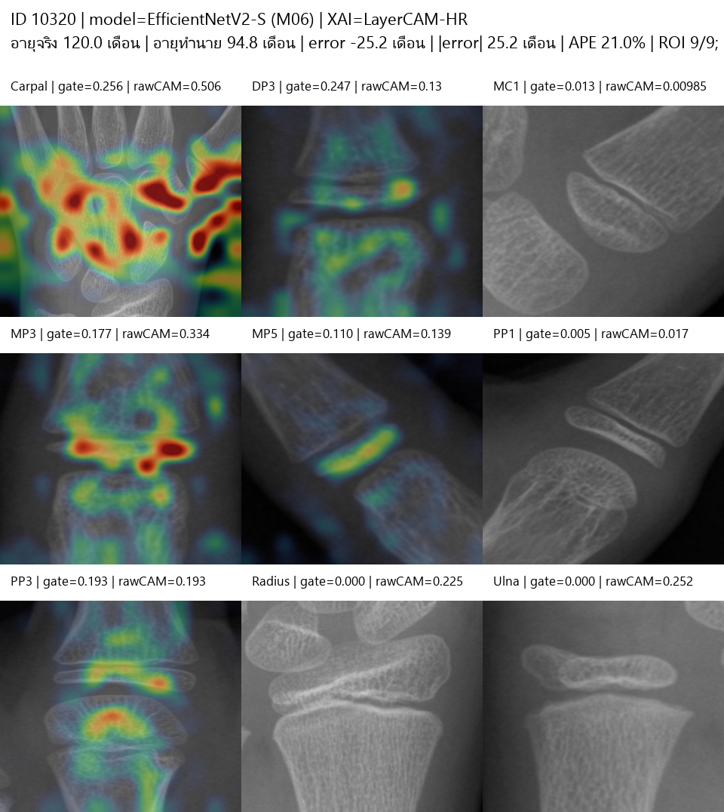

# Skeleton Bone Age XAI

> **Research prototype for automated bone-age estimation from left hand/wrist radiographs.**
> The system detects nine anatomical regions, estimates bone age with FocalNet, and produces a patient-specific XAI overlay for expert review.


## Live research web application

**[Open Skeleton Bone Age on Vercel](https://web-livid-six-41.vercel.app)**

The hosted interface is connected to the real local CPU backend while its secure tunnel is running. It requires an authorised research login; anonymous image upload is intentionally disabled. The application is a research prototype, not a diagnostic service.

## Clinical-review workflow

```text
De-identified hand X-ray → YOLO detects 9 ROIs → QC gate → FocalNet estimates bone age → XAI overlay
```

| Component | Implementation | Role |
| --- | --- | --- |
| ROI localisation | YOLO, 9 anatomical regions | Detects Carpal, DP3, MC1, MP3, MP5, PP1, PP3, Radius, and Ulna. |
| Bone-age model | FocalNet + ROI Transformer + sex | Estimates bone age for ages 1–18 years. |
| Quality control | 9/9 ROI and confidence gate | Withholds prediction if localisation needs expert review. |
| Explanation | ROI-gated SmoothGrad Input × Gradient | Generates an explanation from the same uploaded image. |
| Review workflow | React + FastAPI + audit trail | Separates the raw model output from expert-reviewed values. |

## Validation evidence and safety

The active model is `FULL18 FocalNet — 9 ROI`, with recorded validation MAE **6.58 months**, RMSE **8.56 months**, and R² **0.957** on 260 reviewed-ROI validation cases. These values are not an end-to-end clinical validation claim and are not a confidence interval for an individual patient.

This software is a research prototype. It is not a diagnostic device and must not be used as the sole basis of clinical care. Do not send identifiable patient images through a public endpoint.

### Current validation snapshot

The figure below reports an honest validation comparison across the available model candidates and predeclared ensemble rules. The best displayed fixed rule was the **equal-mean ensemble**: MAE **6.33 months**, RMSE **8.19 months**, within ±3 months **31.5%**, ±6 months **58.1%**, ±9 months **75.0%**, and ±12 months **85.0%** (n=260). These are development/validation results, not a clinical-accuracy claim or a guarantee for an individual examination.



### Curated XAI case gallery

The cases below are de-identified research exports from the same M06 / EfficientNetV2-S evaluation workflow. They deliberately include a low-error, a moderate-error and a high-error example so that the repository does not present only favourable-looking results.

| Case | Recorded result | Why it is shown |
| --- | --- | --- |
| **7423 — low error** | True 144.0 months; predicted 142.1; absolute error **1.9 months**; APE **1.3%**; 9/9 ROI | Clear radiograph and coherent ROI-level XAI. |
| **6543 — moderate error** | True 69.0 months; predicted 73.5; absolute error **4.5 months**; APE **6.5%**; 9/9 ROI | Shows a usable mapping with a clinically relevant prediction difference. |
| **10320 — high error** | True 120.0 months; predicted 94.8; absolute error **25.2 months**; APE **21.0%**; 9/9 ROI | Demonstrates why ROI completeness alone is not evidence of correct age estimation. |

| Case 7423: GradCAM full hand | Case 7423: LayerCAM-HR ROI |
| --- | --- |
|  |  |

| Case 6543: GradCAM full hand | Case 6543: LayerCAM-HR ROI |
| --- | --- |
|  |  |

| Case 10320: GradCAM full hand | Case 10320: LayerCAM-HR ROI |
| --- | --- |
|  |  |

See [the case-example note](docs/CASE_EXAMPLES.md) for interpretation limits and the exact source-record fields used for this selection.

## Start free — actual CPU inference

The model supports CPU execution; no GPU or paid cloud account is required for local research use. The first analysis takes longer while the real YOLO and FocalNet checkpoints load into memory.

```powershell
git lfs install
git clone https://github.com/I-Witsanu02/my-web-smi.git
cd my-web-smi
git lfs pull
python -m pip install -r requirements.txt
npm ci
npm run build
start_cpu.cmd
```

Open `http://127.0.0.1:8766` and upload a de-identified left hand/wrist JPG or PNG.

### Verify real YOLO + FocalNet + XAI from the command line

```powershell
$env:PYTHONPATH = (Get-Location).Path
python scripts\verify_cpu_real_model.py "D:\path\to\deidentified_hand.png" --sex female --age-months 156
```

The verifier prints the device, elapsed time, QC status, ROI count, prediction, and whether XAI was generated. It does not retain the source image.

## Vercel + free local CPU backend

Vercel serves the web interface; the model runs on your own computer. To make the Vercel page use real inference, run `start_cpu_tunnel_safe.cmd`, expose the local backend with a secure HTTPS tunnel, set `VITE_API_BASE_URL` in Vercel, and redeploy.

- Keep Vercel **Root Directory** as `.` (the repository root).
- Confirm `https://YOUR-BACKEND/api/health` returns `"model_available": true`.
- `start_cpu_tunnel_safe.cmd` disables anonymous public-demo uploads and allows the current Vercel production origin only.
- Use a temporary Cloudflare Quick Tunnel only for de-identified demonstration images; its URL changes whenever it restarts.
- For a stable URL, use a named Cloudflare Tunnel with Cloudflare Access.

See [DEPLOYMENT.md](DEPLOYMENT.md) for deployment, secrets, and acceptance checks.

## Project contents

```text
src/                  React interface and clinical-review screens
api/                  Vercel serverless API helpers
app.py                FastAPI inference API for local CPU or GPU use
scripts/              reproducibility and real-inference verification tools
docs/                 validation evidence, selected XAI cases, and screen guide
```

## Application pages

[Open the page-by-page guide](docs/WEB_PAGES.md) for the login, case intake, ROI quality-control, prediction, XAI, report and audit screens.

## Repository safety

This repository intentionally excludes source datasets, identifiable radiographs, runtime uploads, checkpoints, credentials and `.env` files. The three XAI examples below are curated de-identified research exports; do not add new images without confirming data-use approval.
