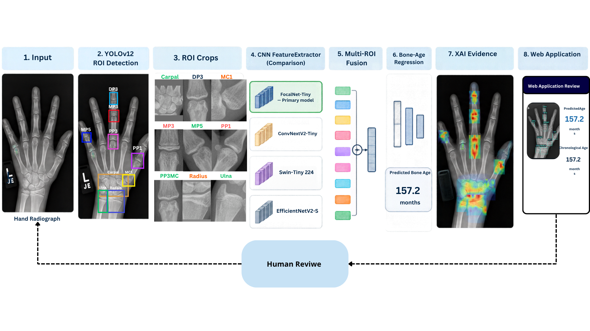
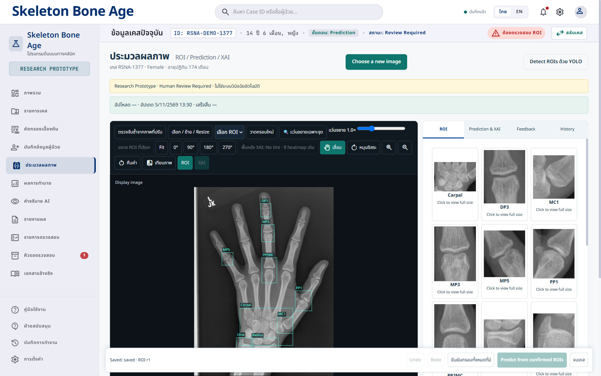
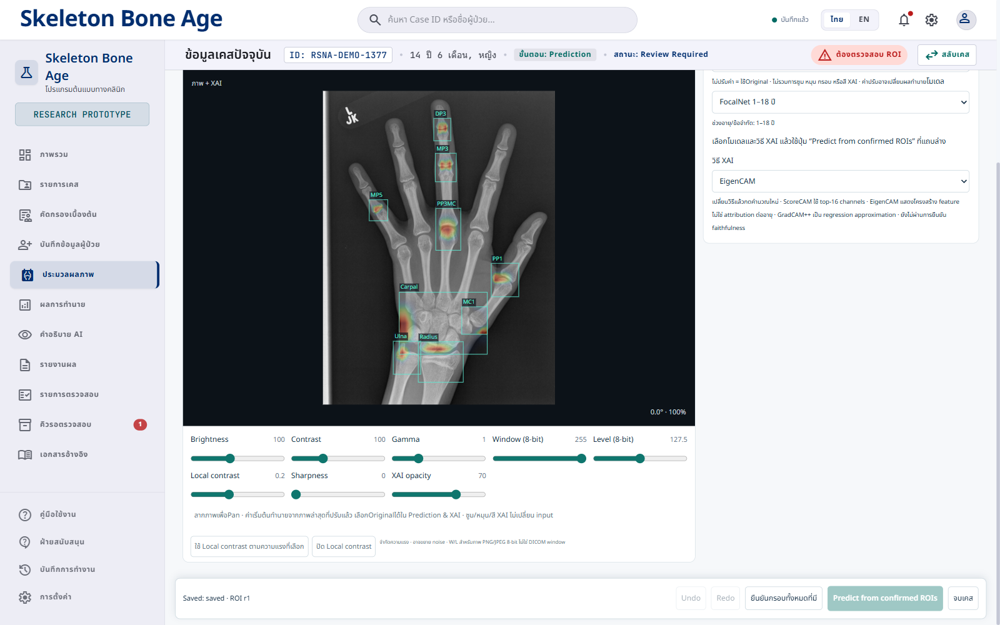
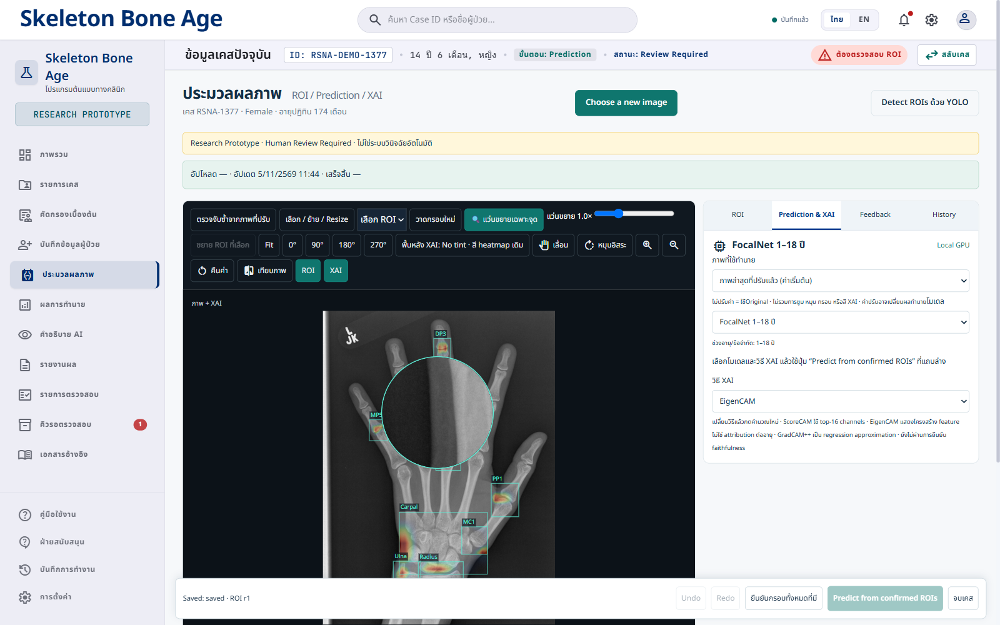
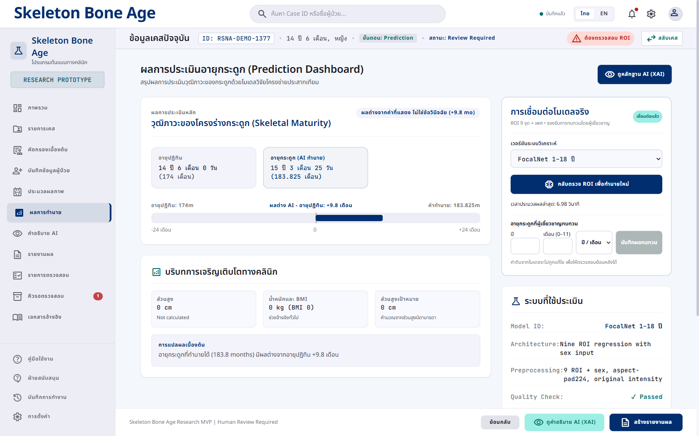
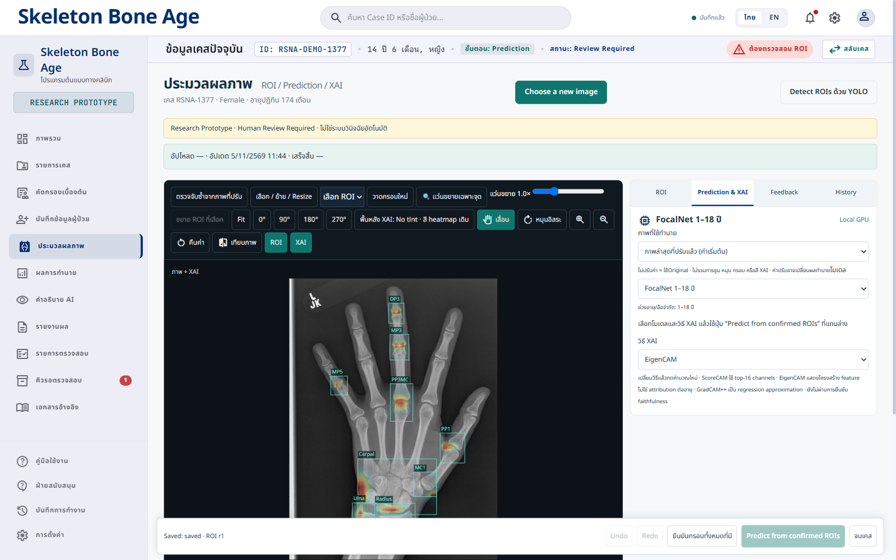
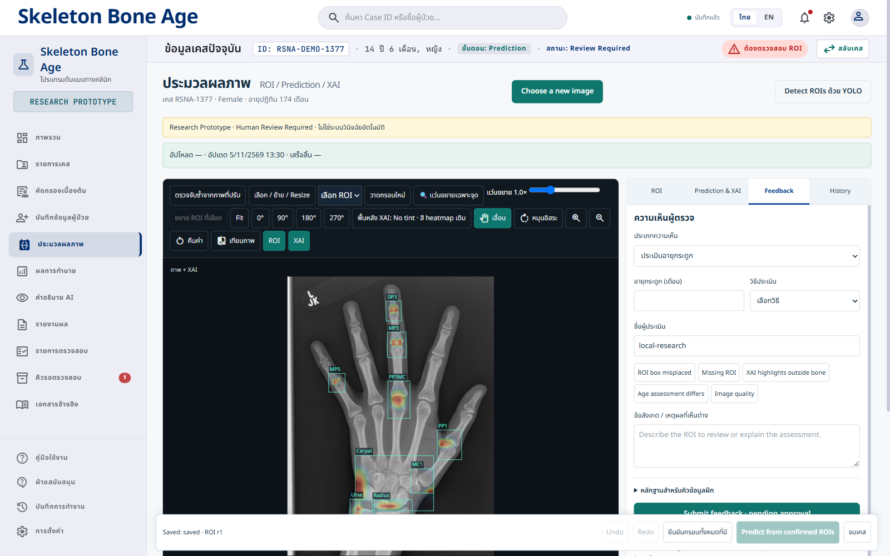
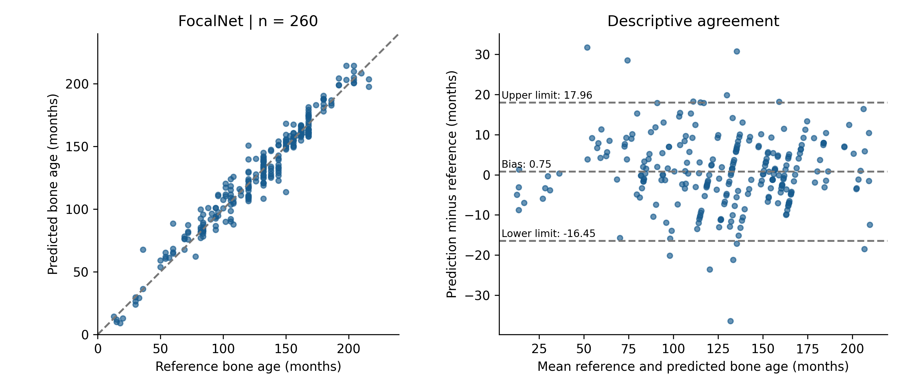
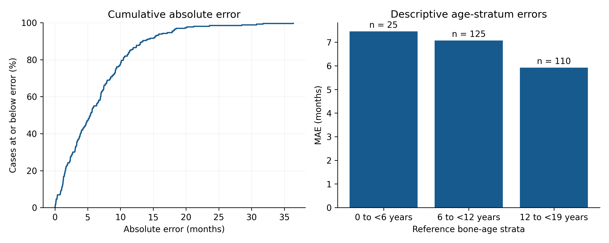
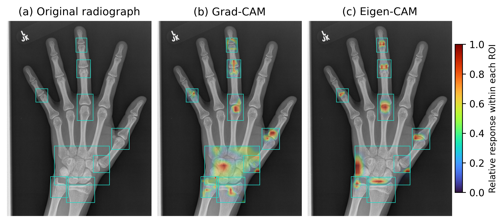

# Skeleton Bone Age XAI

Research software for reviewing bone-age estimates from hand and wrist radiographs. The workflow combines YOLO-based localisation of nine regions of interest (ROIs), a selected regression model, and visual XAI evidence in a human-review interface.

> Research prototype only. It is not a medical device and must not be used to make clinical decisions. A displayed heatmap is a model explanation view, not a probability or proof of causal reasoning.

## What is included

- React/Vite review interface and FastAPI inference service.
- ROI review, manual box adjustment, image enhancement, repeat detection, prediction timing, and XAI views.
- A feedback workflow that records expert review separately. It does **not** update model weights online; any future model update must be an offline, documented release.
- Optional Supabase schema for authenticated accounts, case metadata, prediction records, feedback, and private RSNA image storage. The application does not yet synchronize its local cases or inference records with Supabase. See `docs/SUPABASE_SETUP_EN.md` for the verified boundary and setup steps.

## Workflow and interface gallery



This is the author-supplied architecture illustration. Its detector label is YOLOv12; the local demonstration below used registry entry `yolo_v2_b8_e53_640`. Use the recorded checkpoint hash and registry entry when identifying an experiment.

### Review the nine ROIs and their crops



Select an image, run detection, review the full-image boxes and individual crops, adjust any misplaced box, and confirm all nine ROIs before prediction.

### Inspect the image



Brightness, contrast, gamma, window/level, sharpness, and local contrast support image inspection. If adjusted-image inference is selected, these pixel changes can affect predictions. Zoom, pan, display rotation, loupe magnification, XAI opacity, and blue tint are display controls. Box edits change the crops used for inference and require review again.



### Predict and inspect XAI





The local demonstration used an RSNA sample, detected 9/9 ROIs, returned **182.489 months**, and reported `device=cuda` on an RTX 4050. The request took approximately **5.66 seconds**. This is one demonstration result, not a dataset-level accuracy estimate. Dates in the demonstration case are illustrative; no simulated physician assessment was recorded as ground truth.

### Record feedback



Feedback records preserve model output separately from expert opinion. Curate and approve data, version the dataset, train offline, evaluate the candidate, and approve a new release before changing the served checkpoint. Submitting feedback does not trigger automatic retraining.

## FocalNet evaluation

The manuscript reports one author-selected checkpoint under the name **FocalNet**. The checkpoint identifier and hash are retained in the provenance record rather than used as a second model name.

| Patients | MAE months | RMSE months | Bias months | Within ±6 months | Within ±12 months |
| ---: | ---: | ---: | ---: | ---: | ---: |
| 260 | 6.619 | 8.795 | +0.755 | 55.0% | 86.5% |

The patient bootstrap 95% CI for MAE is **5.937–7.351 months** (20,000 resamples, seed 20261105). These are archived predictions; no training or prediction editing was performed. The records flag prior inspection and possible initialization-data overlap involving 15 patients. Independence has not been established. Tolerance agreement is not classification accuracy.




[Reproducible analysis](docs/manuscript/analysis/run_focalnet_analysis.py) · [Checkpoint provenance](docs/manuscript/FocalNet_provenance.json) · [Reviewed manuscript](docs/manuscript/Manuscript_EN_XAI_Web_Revised.docx)

The loupe screenshot was supplied by the author to show the complete lens over a joint. Interface illustrations document controls and do not constitute checkpoint-matched XAI or clinical usability evidence.

## Requirements

- Windows 10/11 or Linux; Python 3.11 recommended; Node.js 20 LTS; Git.
- Checkpoints are not included in this repository. Obtain model files separately under their applicable licence and data-use terms, then verify their SHA-256 values against your trusted manifest.
- GPU acceleration requires a compatible NVIDIA driver and a PyTorch build matching the installed CUDA runtime. CPU mode may be slower.

## Local installation (Windows)

```powershell
git clone https://github.com/I-Witsanu02/my-web-smi.git
cd my-web-smi
py -3.11 -m venv .venv
.\.venv\Scripts\Activate.ps1
python -m pip install --upgrade pip
pip install -r requirements.txt
npm ci
npm run build
```

Copy `.env.example` to `.env` and set unique local credentials and a random session secret. Add local checkpoint paths and expected SHA-256 values only after acquiring the approved model files. Never commit `.env`, checkpoints, radiographs, or real case data. Then run `start_cpu.cmd` or `start_gpu.cmd` as appropriate and open the local URL printed in the terminal. The GPU launcher verifies that CUDA is available; it does not supply model checkpoints.

For detailed setup, troubleshooting, and safe shutdown, see [Installation guide (Thai)](docs/INSTALL_GUIDE_TH.md), [Secure operations (Thai)](docs/SECURE_OPERATIONS_TH.md), and [Security review (Thai)](docs/SECURITY_REVIEW_TH.md).

## Supabase status

The linked Supabase project has the initial tables, row-level security, and a private storage bucket. This confirms project/schema setup only. There are no application-managed Supabase accounts in the project, and this codebase currently uses its local FastAPI authentication and local persistence. Login, case metadata, predictions, feedback, and image uploads are therefore **not yet synchronized** to Supabase. Do not place a service-role key in the browser or commit any secret. The setup guide explains what remains before enabling integration.

## Model and result provenance

This source repository does not bundle trained weights, patient images, or a clinical test dataset. It also makes no performance claim in this README. Any result reported for a model must identify the exact checkpoint hash, input protocol, eligible case set, exclusions, and evaluation script in the research record accompanying that result.

## Verification

```powershell
npm ci
npm run lint
npm run build
python -m pytest -q
python scripts/check_local_install.py
```

The install check reports whether runtime dependencies, GPU support, and checkpoint files are available on the current machine. A successful web build or `/api/health` response does not demonstrate that a real image was detected or predicted successfully; verify inference with an approved de-identified sample and record the returned model/checkpoint identity.

## Repository layout

```text
src/                  React interface
api/                  lightweight hosting endpoints
app.py                FastAPI inference and review API
model_service.py      model/checkpoint loading
model_registry.json   model definitions and local checkpoint locations
supabase/             optional schema and RLS migrations
docs/                 setup, operations, security, and page guides
tests/                unit and workflow tests
```

## Data handling

Use only images that you are authorized to process. Keep real-world clinical images out of public repositories and shared demos. For the research setup, use the RSNA dataset under its terms. Store credentials in environment variables, keep the image bucket private, apply least-privilege access, and define retention/deletion rules before enabling cloud storage.

## Licence and acknowledgements

Review the repository licence and the licences/data-use terms of each model, dependency, and dataset before redistribution or deployment. This repository's code licence does not grant rights to external datasets or pretrained weights.


### Checkpoint matched regional explanations



The maps use the same FocalNet checkpoint as the numerical analysis. Color is normalized within each ROI; red is a relative response, not confidence or an age contribution. [Figure provenance](docs/manuscript/figures_xai/XAI_figure_provenance.json) · [Revision notes](docs/manuscript/Revision_notes_XAI_Web_TH.md) · [Section comparison](docs/manuscript/Full_section_comparison.csv).


## Local review account and illustrated installation guide

Run `.venv\Scripts\python.exe scripts/setup_local_account.py` to create your own local account (suggested username `Admin_up`). The password is entered privately and saved only in ignored `.env`. The CPU and GPU launchers use this account; no password is distributed through Git. Remember-session is selected by default and expires after 12 hours. Obtain the authorized model checkpoints and hashes separately from the developer. Cloning alone does not include model weights or another machine’s account. See the [illustrated Thai installation and user guide](docs/คู่มือติดตั้งและใช้งาน_Skeleton_Bone_Age_XAI.docx) for commands, expected output, screenshots, shutdown, and troubleshooting.
