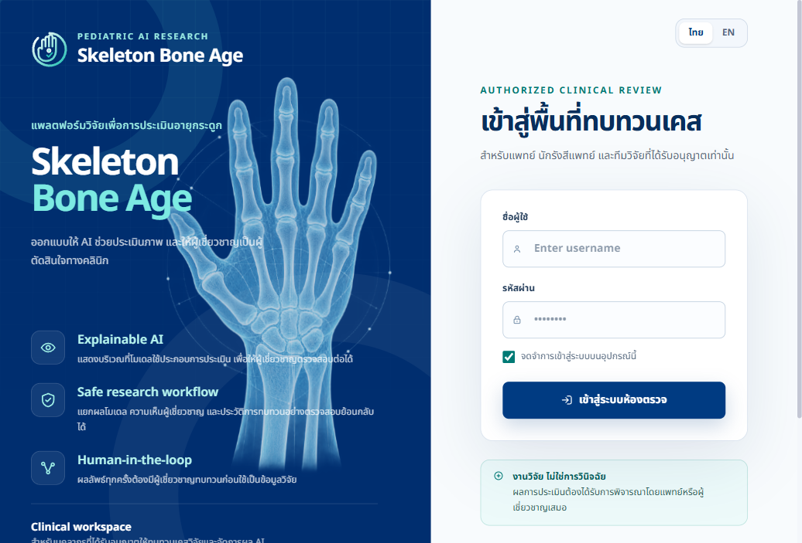
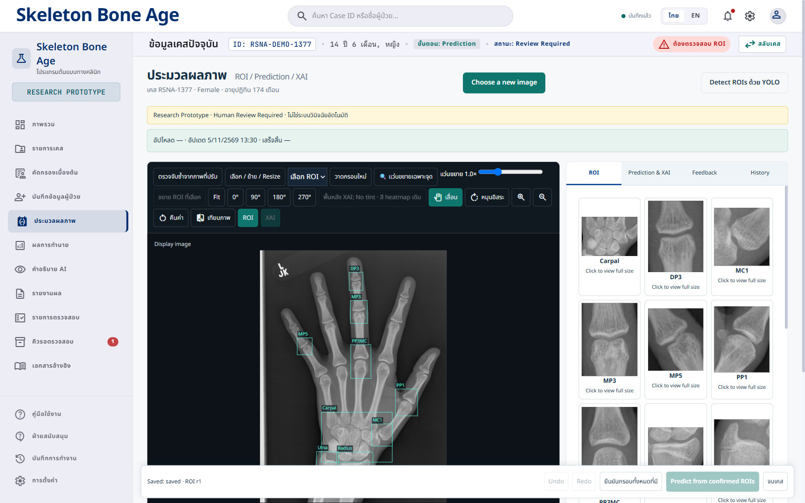
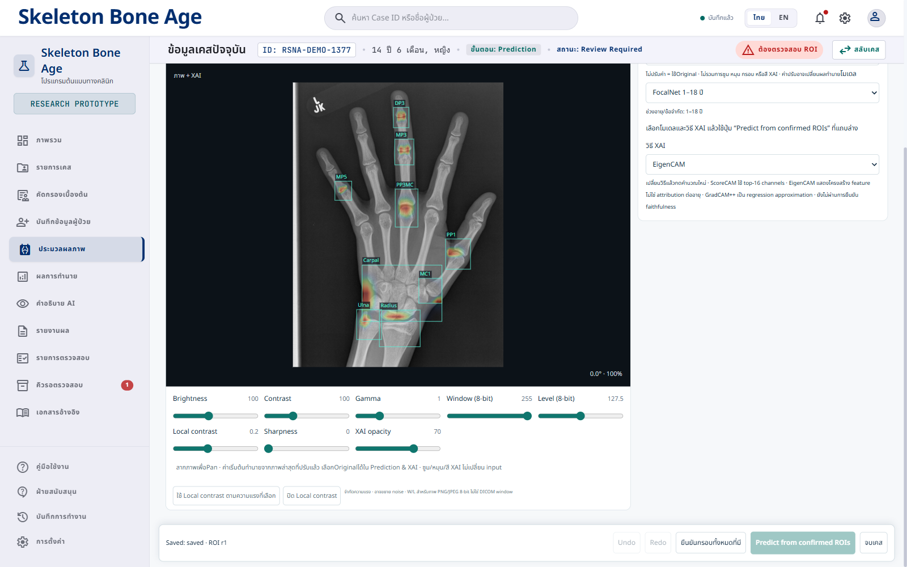
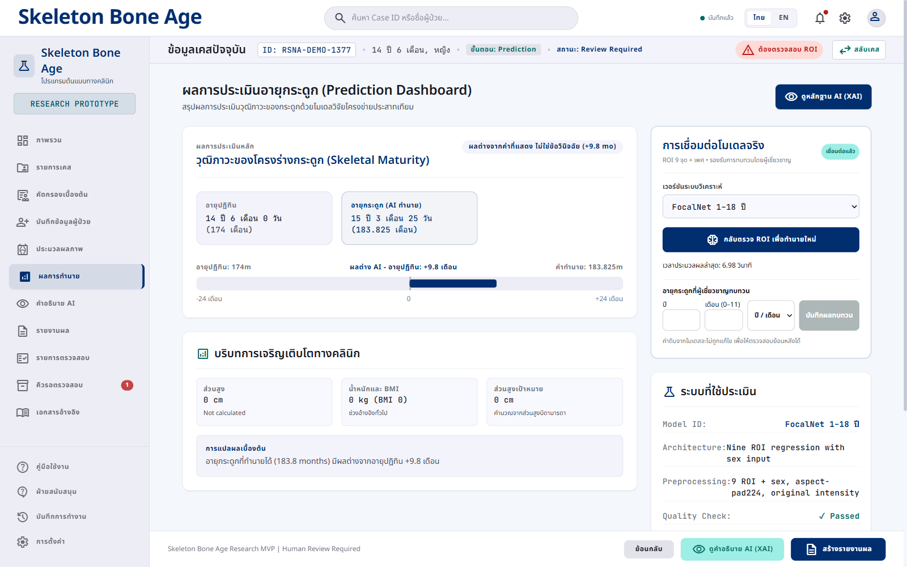
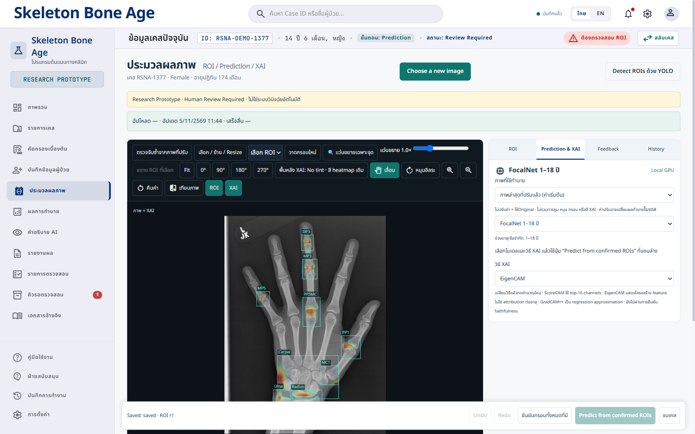
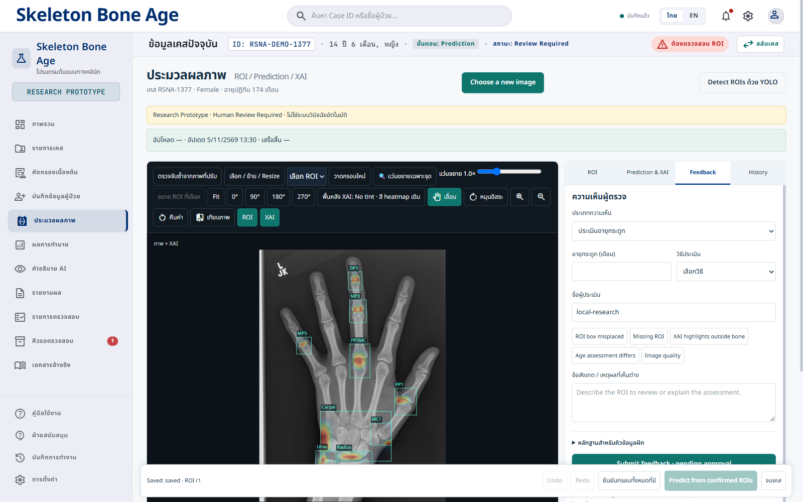

# คู่มือติดตั้งและใช้งาน Skeleton Bone Age XAI

คู่มือนี้ใช้สำหรับอาจารย์หรือผู้ตรวจงานที่ต้องการนำ Source Code ไปเปิดบนเครื่อง Windows ของตนเอง แบ่งเป็นการติดตั้ง การตรวจผล และการใช้งานเบื้องต้น ภาพหน้าจอเป็นตัวอย่างจากระบบของโครงการ ไม่ใช่ผลที่รับประกันว่าจะเท่ากันทุกเครื่อง

## สิ่งที่ต้องรับจากผู้พัฒนา

1. ลิงก์ repository และสิทธิ์เข้าถึงหากใช้ Bone_age ซึ่งเป็น private
2. คู่มือนี้ และ checkpoint FocalNet/YOLO ที่ได้รับอนุญาต พร้อม SHA-256 และรุ่นที่ใช้
3. ภาพ RSNA สาธิตที่มีสิทธิ์ใช้ สำหรับตรวจการทำนายจริง
4. ชื่อผู้ใช้และรหัสผ่านส่งแยกเป็นการส่วนตัว หรือกำหนดใหม่บนเครื่องปลายทาง

git clone ดาวน์โหลดโค้ด ไม่ได้ดาวน์โหลด checkpoint หรือบัญชีของผู้พัฒนาโดยอัตโนมัติ ไม่ส่ง .env ฐานข้อมูลจริง หรือโฟลเดอร์ runtime ขึ้น GitHub

## 1 เตรียมเครื่อง

Windows 10/11, Git, Python 3.11 และ Node.js 20 ขึ้นไป เครื่องที่ไม่มี NVIDIA GPU ใช้ CPU ได้แต่ช้ากว่า

```powershell
git --version
py -3.11 --version
node --version
npm --version
```

ผลที่ควรเห็นคือเลขเวอร์ชันของทั้งสี่โปรแกรม หากขึ้นว่าไม่รู้จักคำสั่ง ให้ติดตั้งและเปิด PowerShell ใหม่ก่อนดำเนินการ

## 2 ดาวน์โหลด Source Code

สำหรับ repository ภาษาอังกฤษที่ใช้ส่งงาน:

```powershell
git clone https://github.com/I-Witsanu02/my-web-smi.git
cd my-web-smi
```

หรือใช้ repository ภาษาไทยเมื่อได้รับสิทธิ์:

```powershell
git clone https://github.com/I-Witsanu02/Bone_age.git
cd Bone_age
```

เลือกเพียง repository เดียว ผลที่ควรเห็นคือโฟลเดอร์ src, scripts, docs และไฟล์ app.py / package.json / model_registry.json หาก private repo แจ้ง Repository not found ให้ผู้พัฒนาเพิ่มสิทธิ์ GitHub ของอาจารย์ ไม่ใช้รหัสผ่านเข้าเว็บแทนสิทธิ์ GitHub

## 3 ติดตั้ง Python และหน้าเว็บ

```powershell
py -3.11 -m venv .venv
.\.venv\Scripts\python.exe -m pip install --upgrade pip
```

ใช้ Python ใน .venv โดยตรง จึงไม่ต้องเปิดสิทธิ์ Activate.ps1 หากใช้ CPU:

```powershell
.\.venv\Scripts\python.exe -m pip install torch torchvision --index-url https://download.pytorch.org/whl/cpu
```

หากใช้ NVIDIA GPU ให้เลือก Windows / Pip / Python / CUDA ที่เหมาะกับ driver จาก https://pytorch.org/get-started/locally/ แล้วใช้ .venv\Scripts\python.exe -m pip แทน pip ในคำสั่งที่เว็บให้ ไม่ติดตั้ง CPU build ทับ CUDA build

```powershell
.\.venv\Scripts\python.exe -m pip install -r requirements.deploy.txt
npm ci
```

ผลที่ควรเห็นคือแพ็กเกจติดตั้งเสร็จโดยไม่มี error ตรวจ GPU ได้ด้วย:

```powershell
.\.venv\Scripts\python.exe -c "import torch; print(torch.__version__); print(torch.cuda.is_available())"
```

True หมายถึง PyTorch เข้าถึง CUDA ได้ หากใช้ CPU ค่า False เป็นเรื่องปกติ ไม่ใช่ผลการตรวจว่าโมเดลทำนายสำเร็จ

## 4 ตั้งบัญชีเฉพาะเครื่อง

```powershell
.\.venv\Scripts\python.exe scripts/setup_local_account.py
```

กรอกชื่อผู้ใช้ ค่าเริ่มต้นคือ Admin_up แล้วกรอกรหัสผ่านสองครั้ง ตัวอักษรรหัสผ่านจะไม่แสดงบนจอ ผลที่ควรเห็นคือ Account saved locally in .env ไม่พิมพ์รหัสผ่านลง log และไม่ส่งรหัสผ่านในไฟล์คู่มือ

อาจารย์กำหนดรหัสเองได้ หรือผู้พัฒนาตั้งเครื่องให้แล้วแจ้งรหัสแยกต่างหาก บัญชีนี้เป็น local review account บทบาท Clinical Reviewer ชื่อ Admin_up ไม่ได้ทำให้กลายเป็นผู้ดูแล Supabase หรือ GitHub

การเรียกคำสั่งนี้ซ้ำจะเปลี่ยนรหัสและ session secret ให้ restart server และเข้าสู่ระบบใหม่ เครื่องปลายทางแต่ละเครื่องมี .env ของตัวเอง บัญชีจากเครื่องผู้พัฒนาไม่ตามไปกับ git clone

ช่องจดจำการเข้าสู่ระบบเลือกไว้เป็นค่าเริ่มต้น ระบบจำ session ไม่เก็บรหัสผ่านในช่องกรอก และหมดอายุหลัง 12 ชั่วโมง ผู้ใช้ยังออกจากระบบได้ ไม่ใช่ auto login ถาวร

## 5 เตรียม checkpoint

สร้างโฟลเดอร์ models และรับไฟล์จากผู้พัฒนาแยกต่างหาก:

```powershell
New-Item -ItemType Directory -Force models
```

โมเดลเริ่มต้นใน registry ใช้ models/focalnet_full18.pt และ detector ใช้ models/yolo_roi9.pt ต้องตรง architecture และ preprocessing ตาม registry ไม่เปลี่ยนชื่อ checkpoint คนละรุ่นเพื่อให้เปิดผ่าน

หากต้องการทดสอบ FocalNet ที่ใช้ใน manuscript ฉบับล่าสุด ให้รับไฟล์รุ่นดังกล่าว วาง models/focalnet_feedback_candidate.pt แล้วเลือกโมเดลนั้นในหน้าเว็บ ชื่อใน registry มี Feedback Candidate เพื่อแยกไฟล์ แม้ในบทความเรียก FocalNet ต้องไม่สับสนกับ baseline ที่เป็นโมเดลเริ่มต้น

```powershell
Get-FileHash .\models\focalnet_full18.pt -Algorithm SHA256
Get-FileHash .\models\yolo_roi9.pt -Algorithm SHA256
```

เทียบ Hash กับเอกสารส่งมอบ checkpoint จากผู้พัฒนา หากต้องใช้พาธอื่น ตั้ง BONEAGE_FULL18_CHECKPOINT และ BONEAGE_YOLO_CHECKPOINT ใน .env เป็นพาธจริง โมเดลเพิ่มเติมใช้ตำแหน่งตาม model_registry.json ไม่จำเป็นต้องติดตั้งทุกโมเดลเพื่อทดสอบโมเดลหลัก

ไม่จำเป็นต้องคัดลอก .env.example ทั้งไฟล์ ค่าตัวอย่าง VITE_API_BASE_URL เป็น URL สมมติ สำหรับการรันเว็บและ API ในเครื่องเดียวกันให้เว้นค่านี้ว่าง ไม่ตั้งให้ชี้ไป placeholder

## 6 Build และเปิดเว็บ

```powershell
npm run build
```

ผลที่ควรเห็นคือโฟลเดอร์ dist และข้อความ build สำเร็จ จากนั้นเลือกเปิดเพียงโหมดเดียว:

```powershell
.\start_cpu.cmd
```

CPU เปิดที่ http://127.0.0.1:8766/ ส่วน GPU:

```powershell
.\start_gpu.cmd
```

GPU เปิดที่ http://127.0.0.1:8770/ ตัวเปิดทั้งสองเลือก Python ใน .venv ก่อน บัญชีที่ตั้งใน .env ใช้ได้ทั้งสองโหมด หาก GPU ไม่มีบัญชีที่ตั้งไว้ ตัวเปิดเดิมยังรองรับบัญชีสุ่มเฉพาะเครื่องใน runtime/gpu_login.json ให้ใช้ขั้นตอนตั้งบัญชีก่อนเพื่อไม่สับสน



ผลที่ควรเห็นคือหน้าเข้าสู่ระบบ ใช้บัญชีเฉพาะเครื่องที่เพิ่งกำหนด การเปิดหน้าเว็บได้ยังไม่ยืนยันว่าโหลดโมเดลสำเร็จ

## 7 ตรวจการติดตั้งและทำนายจริง

```powershell
$env:BONEAGE_DEVICE="cpu"
.\.venv\Scripts\python.exe scripts/check_local_install.py
```

หากตรวจ GPU ให้เปลี่ยน cpu เป็น cuda ผลที่ควรเห็นคือไฟล์โมเดลที่เลือกและ detector มีอยู่ และ CUDA available=True เมื่อใช้ GPU หากขึ้น MISSING ให้ตรวจชื่อ/พาธ checkpoint ส่วน SHA-256 matched จะปรากฏเมื่อกำหนด expected hash ไว้ การตรวจนี้ยังไม่โหลดโมเดลหรือทำนายภาพ

เข้าสู่ระบบ เปิดภาพ RSNA สาธิต ตรวจ 9 ROI และยืนยันกรอบ จากนั้นกดทำนาย ตรวจว่ามีอายุเป็นเดือน โมเดลที่เลือก เวลาใช้ และ XAI ของภาพเดียวกัน จด model ID / checkpoint hash / device / จำนวน ROI ไว้ประกอบการตรวจรับ ไม่ใช้เพียง /api/health เป็นหลักฐานการทำนายจริง

## 8 ใช้งานเว็บเบื้องต้น



เลือกภาพ → ตรวจ YOLO → เทียบกรอบบนภาพกับ crop ทั้ง 9 จุด หากกรอบคลาดเคลื่อนให้เลือก ROI แล้ววาด ย้าย หรือปรับขนาด จากนั้นยืนยันกรอบก่อนทำนาย



Brightness, Contrast, Gamma, Window/Level, Sharpness และ Local contrast ปรับภาพ เมื่อเลือกใช้ภาพที่ปรับแล้ว ค่าพิกเซลส่งเข้าโมเดลและอาจเปลี่ยนผลได้ ส่วน Zoom, Pan, หมุนมุมมอง และแว่นขยายใช้ดูภาพ ไม่เปลี่ยนพิกเซล input โดยอัตโนมัติ หลังปรับภาพสามารถตรวจจับซ้ำและตรวจกรอบใหม่



ผล AI เป็นอายุกระดูก เก็บแยกจากอายุปฏิทินและอายุที่ผู้เชี่ยวชาญประเมิน เลือกโมเดลและวิธี XAI ก่อนกดทำนายจากกรอบที่ยืนยัน



สีแดงเป็นการตอบสนองสัมพัทธ์ตามวิธีและ normalization ไม่ใช่ความมั่นใจหรือจำนวนเดือนที่กระดูกจุดนั้นเพิ่มให้ผล EigenCAM เป็น feature visualization ไม่ใช่ attribution ที่เจาะจงอายุ



กรอกความเห็นผู้เชี่ยวชาญและเหตุผล ระบบแยกจากผลโมเดลเดิม การส่ง feedback ไม่ฝึกโมเดลทันที ต้องตรวจข้อมูล จัด dataset version ฝึก offline ประเมิน และอนุมัติรุ่นก่อนใช้งาน

## 9 ปิดและเปิดครั้งถัดไป

หากเปิด API ในหน้าต่างคำสั่งโดยตรง ให้กด Ctrl+C ในหน้าต่างนั้น วิธีเปิดแบบเห็น log:

```powershell
.\.venv\Scripts\python.exe -m uvicorn app:app --host 127.0.0.1 --port 8766
```

สำหรับตัวเปิดแบบ background ใช้คำสั่งต่อไปนี้หลังบันทึกงานและไม่มีคำขอทำนายค้างอยู่:

```powershell
powershell -NoProfile -File scripts/stop_local.ps1
```

คำสั่งนี้ตรวจว่า process เป็น BoneAge จากโฟลเดอร์นี้ก่อนหยุด ไม่หยุด Python โปรแกรมอื่น เปิดครั้งต่อไปใช้ start_cpu.cmd หรือ start_gpu.cmd ได้เลย ไม่ต้อง npm ci ใหม่ถ้า dependency ไม่เปลี่ยน

## 10 ปัญหาที่พบบ่อย

- เข้าเว็บไม่ได้: ตรวจ port CPU 8766 / GPU 8770 และ log runtime/gpu_stderr.log หากใช้ GPU
- เข้าระบบไม่ได้: รัน setup_local_account.py ใหม่ แล้ว restart API ค่า .env มีผลเมื่อเริ่ม process
- ไม่มีโมเดลหรือทำนายไม่ได้: ตรวจ checkpoint จริง รุ่นที่เลือก registry และ dependencies ไม่แก้ด้วยการใส่ค่าทำนายตัวอย่าง
- CUDA=False: ใช้ CPU ได้ หรือติดตั้ง PyTorch CUDA ให้ตรง driver
- หน้าจอไม่อัปเดต: npm run build แล้ว refresh Ctrl+F5
- Supabase: การติดตั้งนี้ใช้ local authentication และ SQLite ยังไม่เปิดการเชื่อม Supabase ตามที่ผู้พัฒนาพักงานไว้

## รายการส่งอาจารย์

Source Code + คู่มือฉบับนี้ + Manuscript + checkpoint ที่ได้รับอนุญาตและ hash + ภาพทดสอบที่มีสิทธิ์ใช้ ส่งชื่อผู้ใช้/รหัสผ่านแยกส่วนตัว หรือให้อาจารย์ตั้งเอง ห้ามใส่รหัสจริงลง README, GitHub หรือ PDF คู่มือที่เผยแพร่

ตัวอย่างการจัดหน้า README ศึกษาจาก https://github.com/topics/medical-website และ https://github.com/mhmiyazi/Medical-Website โดยนำแนวคิดภาพตัวอย่าง/ลิงก์สาธิตมาใช้ ไม่ได้ใช้โค้ดเว็บไซต์เหล่านั้นแทนระบบวิจัยนี้ รายละเอียดติดตั้ง PyTorch อ้างอิง https://pytorch.org/get-started/locally/
